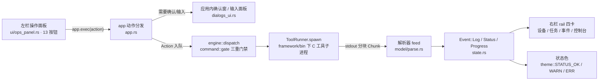
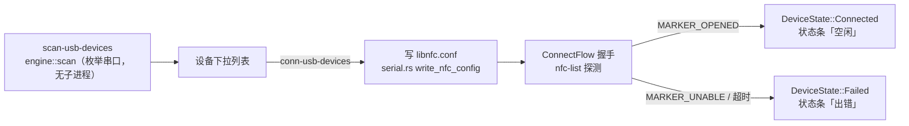
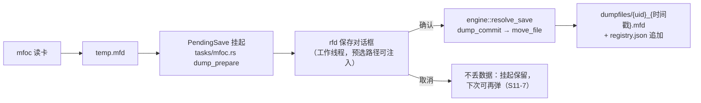
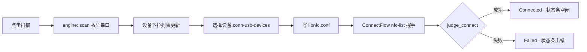
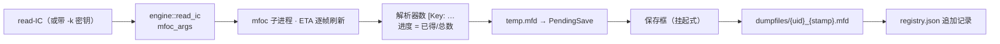
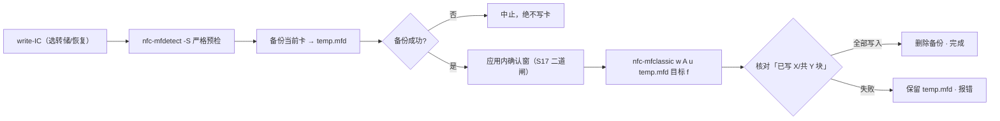
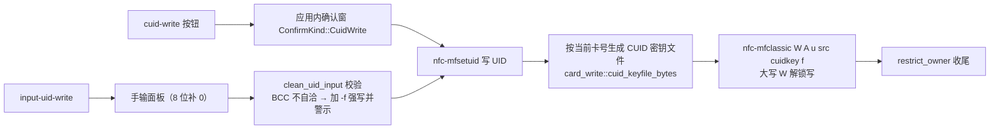
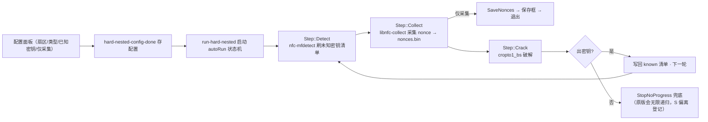
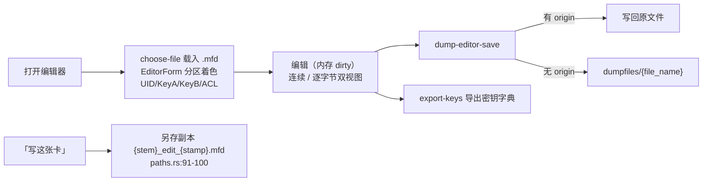

# 07 · 功能完整链路测试验证

> 面向**验证者**的端到端手册：每个功能从「UI 点击」到「后端工具执行 → 结果解析 →
> UI 反馈 / 文件落盘」逐跳给出代码锚点与验证方法。
>
> 与 [docs/04](04-测试计划.md) 的分工：04 定测试策略与 39 action parity 表；
> 07 按功能给出「链路图 → 逐跳验证 → 自动化锚点 → 无硬件复现 → 真机步骤 → 失败模式」。
>
> **行号说明**：文中 `文件:行号` 为撰写时（v1.0.0，main 分支）快照，后续提交可能漂移；
> 检索时以「函数名 + 文件」为准。锚点一律给到函数/常量级。

## 0. 怎么用这份文档

三类用法：

1. **改代码后的回归**：按 §4 矩阵跑自动化（本地 + CI），失败按 §3 对应节的链路定位。
2. **无硬件验证**：没有读卡器时，用 §3 各节「无硬件复现」列出的 Mock/fixture 用例走通链路。
3. **发版前真机验收**：过 §5 总清单（覆盖 README「真机验收清单」全部条目 + 界面改版增量）。

自动化资产总览：

| 资产 | 规模 | 入口 |
|---|---|---|
| core selftest | 14 项 | `cargo run -p nfc-core -- --selftest` |
| app selftest | 101 项 | `cargo run -p nfc-app -- --selftest` |
| cargo test（workspace） | 630 项 | `cargo test --workspace` |
| 真实 C 工具集成测试 | real_tools + tool_cli | `NFC_FRAMEWORK_BIN=./framework/bin cargo test -p nfc-core --test real_tools --test tool_cli` |
| 静态门禁 verify_parity | 847 项 | `python3 tools/verify_parity.py` |
| CI | 2 个 job | `.github/workflows/ci.yml`（push/PR 触发） |

## 1. 全链路总览

### 1.1 主链（每个动作共用）

关键跳点：

| 跳点 | 锚点 | 说明 |
|---|---|---|
| 按钮 → exec | `ui/ops_panel.rs` `action_button`（`resp.clicked()` → `app.exec`） | 点击前先过 `command::gate`，未过则按钮置灰、悬停显示原因 |
| 动作分发 | `crates/nfc-app/src/app.rs` `exec` | 打开确认窗/输入面板，或转成 `Action` 入 engine 队列 |
| 门禁 | `crates/nfc-core/src/command.rs:338` `gate` | 未连接 `NotConnected` / 忙 `Busy` / 连接中 `Connecting`，文案见 `GateError::i18n_key` |
| 派发与启动 | `crates/nfc-core/src/engine.rs:368` `dispatch` → `launch/launch_with_status` | 记命令行日志、置 `is_running_task`、发 `Indicator::Running`、设 ETA 基线 |
| 子进程执行 | `crates/nfc-core/src/runner.rs` `NfcToolRunner` | spawn `framework/bin` 下 10 个 C 工具之一；设 `LIBNFC_SYSCONFDIR` |
| 逐块解析 | `engine.rs:1355` `pump` → `engine.rs:1398` `feed` | stdout 按块喂解析器，产出日志/进度/密钥事件 |
| 收尾 | `engine.rs:1588` `finish` | 退出码 + 解析器终态定音，`Event::TaskDone`，复位任务条 |
| UI 反馈 | `crates/nfc-app/src/ui/rail.rs` 四卡 | 事件最新在上（上限 30 条）；日志 1 MiB 环形、显示 256 KiB |

### 1.2 旁路一：设备扫描与连接握手

连接判读三态见 `crates/nfc-core/src/serial.rs` `ConnectFlow` + `judge_connect`
（成功标记优先于失败标记）。热插拔由 `PortScanner` 轮询，**端口列表有变化才推送**。

### 1.3 旁路二：读卡落盘与挂起式保存

`move_file` 对跨盘移动做 EXDEV 兜底（copy + delete），见 `crates/nfc-core/src/tasks/mfoc.rs`。
时间戳规则见 `crates/nfc-core/src/paths.rs` `timestamp`（本地时区 `yyyy_MM_dd_HH_mm_ss`）。

### 1.4 状态与事件模型

- `crates/nfc-core/src/state.rs`：`DeviceState`（None/Connecting/Connected/Failed…）、
  `Indicator`（Free/Running/Error）、`EventKind`/`EventItem`（事件条）、`StatusInfo`（状态条）。
- 状态色常量：`crates/nfc-core/src/theme.rs:197-201`
  `STATUS_OK #54ad6c`、`STATUS_WARN #b6b239`、`STATUS_ERR #cf4152`。
- 主题三态（深/浅/跟随系统）在 `crates/nfc-app/src/panels.rs`，桥接 egui 在 `theme_ui.rs`。

## 2. 39 action 速查表

来源：`crates/nfc-core/src/command.rs:13-54`（顺序即原版 `command.js` actions map）+
`ACTION_SPECS` 门禁注册表；UI 触达点来自 `crates/nfc-app/src/ui/ops_panel.rs` `GROUPS`
（四组 13 按钮：1 读卡区 / 2 破解区 / 3 写卡区 / + 更多）。其余 action 经面板、
标题栏、引导条或对话框触达。

门禁列：「连」= 需设备已连接，「闲」= 需无任务运行，「接」= 连接过程中禁止。

| # | action | UI 触达点 | 连 | 闲 | 后端工具 / 命令 | 落盘 | 备注 |
|---|---|---|---|---|---|---|---|
| 1 | open-settings-window | 标题栏 | | | — | — | 打开设置面板 |
| 2 | scan-usb-devices | 标题栏/设备区 | | | 串口枚举（无子进程） | — | 刷新设备下拉 |
| 3 | conn-usb-devices | 设备下拉/连接按钮 | | | `nfc-list`（握手） | libnfc.conf | 唯一「连接中禁止」的 action |
| 4 | read-IC | 按钮·组1 | ✓ | ✓ | `mfoc` | temp.mfd → dumpfiles/ | MFOC 解卡读卡 |
| 5 | write-IC | 按钮·组3 | ✓ | ✓ | `nfc-mfdetect -S` 预检 → `nfc-mfclassic w A u … f` | 备份 temp.mfd | 两段式，成功才删备份 |
| 6 | format-card | 按钮·组3（危险） | ✓ | ✓ | `nfc-mfclassic f A u temp temp f` | 备份 temp.mfd | 应用内确认 + engine 二道闸 |
| 7 | input-keys-read-IC | 按钮·组1 | | ✓ | — | — | 打开已知密钥输入面板 |
| 8 | done-input-keys-read-IC | 面板内 | ✓ | ✓ | `mfoc -k …` | 同 read-IC | 带已知密钥读卡 |
| 9 | detect-card-type | 按钮·组1 | ✓ | ✓ | `nfc-mfdetect` | — | 卡型探测 |
| 10 | write-ufuid-uid | 按钮·组+ | ✓ | ✓ | `nfc-mfsetuid -q <block0>` | — | UFUID 写 UID |
| 11 | lock-ufuid | 按钮·组+（危险） | ✓ | ✓ | `nfc-mflock -q` | — | 锁卡（不可逆） |
| 12 | hard-nested | 按钮·组2 | | ✓ | — | — | 打开 HardNested 配置面板 |
| 13 | hard-nested-config-done | 面板内 | ✓ | ✓ | — | — | 保存配置（内存态） |
| 14 | run-hard-nested | 面板内 | ✓ | ✓ | `nfc-mfdetect` → `libnfc-collect` → `cropto1_bs` 多轮 | nonces.bin（采集步） | autoRun 状态机 |
| 15 | open-dict-file | 字典测试面板 | | | rfd 选文件 | — | 预选仓库根 `dict.dic` |
| 16 | dict-test | 按钮·组2 | | ✓ | — | — | 打开字典测试面板 |
| 17 | dict-test-config-done | 面板内 | ✓ | ✓ | `nfc-mfdict -s -t -l -d` | — | 字典跑卡 |
| 18 | open-history-keys | 历史面板 | | | — | 读 keys.txt | 历史密钥 |
| 19 | open-dump-editor | 历史/更多入口 | | | — | — | 打开转储编辑器 |
| 20 | dump-editor-choose-file | 编辑器面板 | | | rfd 选 .mfd | — | 载入编辑器 |
| 21 | dump-editor-save | 编辑器面板 | | | — | 写回原文件或 `dumpfiles/<file_name>` | `Action::SaveDump` |
| 22 | open-dump-comparator | 历史面板 | | | — | — | 打开转储比较器 |
| 23 | dump-comparator-choose-file | 比较器面板 | | | rfd 选 .mfd | — | 载入第二份转储 |
| 24 | open-dump-folder | 设置/历史 | | | 系统资源管理器 | — | 打开 dumpfiles/ |
| 25 | dump-history | 历史面板 | | | — | — | 历史转储列表 |
| 26 | delete-dump | 历史面板 | | | — | 删除 .mfd | 需确认 |
| 27 | rename-dump-file | 历史面板 | | | — | 重命名 .mfd | — |
| 28 | cancel-task | 右栏任务卡 | | | kill 子进程 | — | killed 分支不复位为「出错」 |
| 29 | save-log | 右栏控制台卡 | | | — | `NFCTools_log_{时间戳}.txt` | 另存日志 |
| 30 | open-about | 标题栏/更多 | | | — | — | 关于面板 |
| 31 | open-phw-window | 按钮·组+ | | | — | — | 手机/手环操作区开关 |
| 32 | phw-read-uid | 手机/手环面板 | ✓ | ✓ | `nfc-mfdetect` 预检 → 读块 0 | — | S14 |
| 33 | phw-write-uid | 手机/手环面板 | ✓ | ✓ | `nfc-mfsetuid -q <block0>`（不追加 `-f`） | — | S14；工具侧拒绝坏 BCC |
| 34 | phw-write-data | 手机/手环面板 | ✓ | ✓ | `nfc-mfclassic`（patch_phw_block） | — | S14 写数据扇区 |
| 35 | cuid-write | 按钮·组+ | ✓ | ✓ | `nfc-mfsetuid` + `nfc-mfclassic W A u <src> <cuidkey> f` | CUID 密钥文件 | S18；大写 `W` 解锁写 |
| 36 | input-uid-write | 按钮·组+ | | ✓ | — | — | S18 手输卡号面板 |
| 37 | done-input-uid-write | 面板内 | ✓ | ✓ | `nfc-mfsetuid -q <block0>`（BCC 不自洽加 `-f`） | — | S18；8 位卡号补 0 |
| 38 | dump-editor-export-keys | 编辑器面板 | | | — | 导出密钥字典 txt | S18 纯文件操作 |
| 39 | run-mfcuk | 按钮·组+ | ✓ | ✓ | `mfcuk` | — | S18 全加密爆破，一轮可出多把密钥 |

工具全集（10 个）定义在 `crates/nfc-core/src/runner.rs` `KNOWN_TOOLS`：
`nfc-list mfoc nfc-mfclassic nfc-mfdetect nfc-mfdict nfc-mfsetuid nfc-mflock
libnfc-collect cropto1_bs mfcuk`。`nfc-list` 是唯一豁免「未连接」门禁的工具
（`ALWAYS_ALLOWED`，对标原版 `cmd !== "nfc-list"`）。

## 3. 功能链路验证手册

每节统一模板：**链路**（mermaid）→ **逐跳验证表**（跳点/锚点/验证内容）→
**自动化锚点**（app selftest `c_*`、core 测试、verify_parity 段、CI）→
**无硬件复现**（Mock/fixture 用例，精确到测试名）→ **真机步骤** → **失败模式与安全闸**。
selftest 名称均可在 `crates/nfc-app/src/selftest.rs` / `crates/nfc-core/src/bin/selftest.rs`
中检索；engine 内联测试在 `crates/nfc-core/src/engine.rs` 文件尾测试区。

### 3.1 设备扫描与连接（scan-usb-devices / conn-usb-devices）

逐跳验证：

| 跳点 | 锚点 | 验证内容 |
|---|---|---|
| 扫描 | `engine.rs` `scan`（不经 ToolRunner 门禁） | 枚举结果进入设备下拉；无设备时给出空态 |
| 写配置 | `serial.rs` `write_nfc_config` | 模板与原版对拍（verify_parity D-G 段） |
| 握手 | `serial.rs` `ConnectFlow::begin/finish` + `judge_connect` | 成功标记优先于失败标记（M 段钉死） |
| 收尾顺序 | `serial.rs` `finish` | 先 `DeviceState` 后 `TaskDone`；成功发「空闲」、失败发「出错」；被 kill 不复位 |
| 热插拔 | `serial.rs` `PortScanner` | 端口列表**有变化才推送**事件 |

自动化锚点：app selftest `c_scan_populates_device_list` / `c_connect_reaches_connected` /
`c_connect_failure_ends_in_failed` / `c_connect_cancel_keeps_status_free` /
`c_disable_dropdown_while_connecting` / `c_hotplug_interval`；core `serial.rs` 单测 ≥17 项、
`tests/integration.rs` 连接三态用例；verify_parity M 段（收尾顺序/状态条复位）、L 段（结构）。

无硬件复现：`cargo test -p nfc-core --test integration`（`MockSerial` 注入端口列表与
`nfc-list-opened.txt` / `nfc-list-unable.txt` fixture，见 `crates/nfc-core/tests/fixtures/`）。

真机步骤：

| 步骤 | 预期 |
|---|---|
| 1. 启动程序，不插读卡器 | 设备下拉为空，状态条「未连接」 |
| 2. 点「扫描设备」 | 列表仍为空（或仅出现虚拟串口） |
| 3. 插入 PN532 读卡器，再扫描 | 下拉出现 `/dev/tty.*`（macOS）或 COMx/ttyUSBx |
| 4. 选择设备并连接 | 日志出现连接命令行；成功后状态条「空闲」、设备卡变绿 |
| 5. 连接中再次点连接 | 按钮置灰，悬停提示「正在连接设备」 |
| 6. 拔掉读卡器后操作 | 任务以失败收尾，状态条「出错」，事件卡有原因文案 |

失败模式：握手超时（检查接线/波特率）；`Unable to open NFC device`（权限/占用）；
深层扫描需勾选「深层扫描」开关（runner 设 `LIBNFC_INTRUSIVE_SCAN=1`）。

### 3.2 MFOC 读卡（read-IC / input-keys-read-IC / done-input-keys-read-IC）

逐跳验证：

| 跳点 | 锚点 | 验证内容 |
|---|---|---|
| 参数构造 | `tasks/mfoc.rs` `mfoc_args` / `mfoc_keys_total`（含 `-k` 密钥参数提取） | 命令行与原版 `command.js:632` 对齐 |
| ETA | `tasks/mfoc.rs` `EtaTracker` / `apply_eta` | 1s 节流（首帧即节流，S 偏离 #15）；进度 100 只发一次 |
| 落盘 | `tasks/mfoc.rs` `dump_prepare` / `dump_commit` / `dump_save` / `move_file` | EXDEV 跨盘兜底；保存名 `{uid}_{stamp}.mfd`（`paths.rs`） |
| 历史登记 | `crates/nfc-core/src/data.rs`（registry.json） | 读卡完成按 UID 追加 `{uid,bcc,serial,…,date}` |
| UI 快照 | `app.rs` `on_dump_saved_ui` → `ui/workbench.rs` `build_snapshot` | 读卡完成后中栏出现卡片档案（UID/卡型/分组） |

自动化锚点：app selftest `c_read_ic_save_round_trip` / `c_dump_saved_guidance` /
`c_dump_saved_guidance_carries_dump_id` / `c_pending_is_consumed_not_dropped` /
`c_engine_output_reaches_log` / `c_busy_blocks_second_action` / `c_card_snapshot`；
engine 内联测试（ETA、registry 追加、密钥文件不截断）。

无硬件复现：`cargo test -p nfc-core --test integration`（`mfoc-output.txt` fixture 驱动
解析器分块不变性与密钥计数）；`cargo run -p nfc-app -- --selftest` 中的
`c_read_ic_save_round_trip` 用 `MockToolRunner` 走完「读卡 → 保存 → 落盘」全程。

真机步骤：

| 步骤 | 预期 |
|---|---|
| 1. 连接设备，放上 M1 卡 | 状态条「空闲」 |
| 2. 点「读卡」（组1 主按钮） | 任务条「正在解卡」，控制台持续刷 ETA 与 `[Key: …]` 计数 |
| 3. 等待完成 | 状态条回「空闲」；弹出系统保存框（预选 `dumpfiles/`） |
| 4. 保存 | `dumpfiles/{uid}_{stamp}.mfd` 生成；历史面板出现该记录；中栏出现卡片档案 |
| 5. 点「已知密钥读卡」并输入密钥后读卡 | `mfoc` 带 `-k` 参数，速度显著加快 |
| 6. 读卡中点「取消」 | 子进程被 kill，任务条收尾且状态条**不**变成「出错」 |

失败模式：未知卡型/加密卡解不出（看 `guidance_for_unknown` 引导文案）；保存框被系统
拦截时挂起不丢（S11-7，`c_pending_save_not_reposted` / `c_pending_save_no_portal_autosave`）。

### 3.3 卡型探测（detect-card-type）

链路：按钮 → `engine` `plain`/detect 编排 → `nfc-mfdetect` → 解析器出卡型与密钥信息 →
日志/事件反馈；未知卡走 `tasks/detect.rs` `guidance_for_unknown` 引导。

自动化锚点：`tests/integration.rs`（`mfdetect-keys.txt` fixture：密钥去重）；真机放卡点
「检测卡型」，日志应出现卡型（如 MIFARE Classic 1K）与已知密钥段。

### 3.4 写卡与恢复（write-IC）

逐跳验证：

| 跳点 | 锚点 | 验证内容 |
|---|---|---|
| 备份闸 1 | `engine.rs` `read_then_exec`（:1223，`nfc-mfdetect -S` 严格模式） | 备份文件缺失/为空**绝不**进入写卡 |
| 确认闸 2 | `dialogs_ui.rs` 应用内确认窗 + engine 侧 `confirm_danger`（独立第二道） | 覆盖 6 个危险动作；批准一次性（`c_approval_is_single_use`） |
| 写参数 | `tasks/card_write.rs:153` `prepare_write`（`nfc-mfclassic w A u <src> <temp> f`，对标 `command.js:117`） | 命令行对拍（`tool_cli.rs`） |
| 块计数核对 | engine 收尾（不只看退出码） | 「已写 X/共 Y 块」全齐才删备份 |
| CUID 分支 | `engine.rs:1275-1330` `start_next_stage` | 按当前卡号生成密钥文件 + 大写 `W` 解锁 + `restrict_owner` |

自动化锚点：app selftest `c_write_ic_flow` / `c_write_ic_cancel_file` /
`c_write_ic_cancel_confirm` / `c_backup_nonzero_blocks_write` / `c_approval_does_not_leak` /
`c_approval_is_single_use` / `c_engine_never_opens_dialog`；engine 内联 `write_ic_*`
六场景（engine.rs 测试区）。

无硬件复现：`cargo test -p nfc-app -- --selftest`（`c_write_ic_flow` 用 Mock 走
「备份 → 确认 → 写 → 计数核对 → 删备份」全程）；`cargo test -p nfc-core --test tool_cli`
把 engine 会 spawn 的写卡命令行喂给真实二进制验参数（有 `framework/bin` 时）。

真机步骤：

| 步骤 | 预期 |
|---|---|
| 1. 放可写卡，选一份 .mfd 转储，点「写卡」 | 先见备份日志，再弹应用内确认窗（红字警示） |
| 2. 确认后写卡 | 任务条显示逐块进度；完成后提示成功，备份被清理 |
| 3. 写卡中拔掉读卡器 | 任务立即中止、报错；**不**误报成功（安全闸，README 真机清单项） |
| 4. 用只读卡/坏卡重试 | 备份或写入失败即中止，temp.mfd 保留可恢复 |

失败模式：见 `docs/02 §6` 危险确认改应用内的偏离登记；`c_approval_does_not_leak`
保证确认不跨任务泄漏。

### 3.5 格式化（format-card）

链路：按钮（红描边 Danger）→ 应用内确认窗 → engine 二道确认 → `nfc-mfdetect -S` 预检 →
备份 → `nfc-mfclassic f A u temp temp f`（对标 `command.js:145`）→ 块计数核对 → 删备份。

自动化锚点：app selftest `c_format_card_two_stage` / `c_format_card_backup_guard` /
`c_format_card_confirm_required`；engine 内联测试（格式化与锁卡确认，engine.rs 测试区）。

真机：格式化一张废卡 → 全卡变默认 ACL（`FF 07 80`）与默认密钥；格式化中拔卡 → 中止且
备份保留。

### 3.6 UFUID 写 UID 与锁卡（write-ufuid-uid / lock-ufuid）

链路：按钮 → 确认窗 → `tasks/card_write.rs:207` `uid_to_block0` + `block0_bcc_ok`
（BCC 不自洽拒绝，返回可执行 `nfc-mfsetuid` 的 hex）→ `nfc-mfsetuid -q <block0>`；
锁卡走 `nfc-mflock -q`（`mflock_args`，`card_write.rs:172`，对标 `command.js:231`）。

自动化锚点：app selftest `c_write_uid_flow` / `c_write_uid_shows_block0` /
`c_lock_ufuid_flow`；无硬件复现：`cargo test -p nfc-core`（card_write 单测覆盖
block0/BCC 构造）。

真机：UFUID 卡写新 UID 后用 `nfc-list` 应读到新 UID；锁卡后 UID 不可再改（不可逆，
先确认卡是 UFUID/可锁卡型）。

### 3.7 CUID 写卡与手输卡号（cuid-write / input-uid-write / done-input-uid-write）

逐跳验证：

| 跳点 | 锚点 | 验证内容 |
|---|---|---|
| 确认窗 | `app.rs` `exec("cuid-write")` → `ConfirmKind::CuidWrite` | 未确认不入队 |
| UID 归一 | `tasks/card_write.rs` `clean_uid_input` / `uid_to_block0` / `block0_bcc_ok` | 8 位卡号补 0 成 16 位；BCC 自洽性校验 |
| 强写警示 | `engine.rs:942` `input_uid_write` | BCC 不自洽时加 `-f` 并在日志警示（可能砖卡） |
| 密钥文件 | `paths.rs` `cuid_keyfile` + engine `restrict_owner` | 按卡号生成、写完收权 |
| 块数 | engine 内联测试（CUID 64 块计数） | 1K 卡全块写齐 |

自动化锚点：app selftest `c_cuid_write_flow` / `c_uid_input_invalid` / `c_uid_input_valid`；
verify_parity H 段（S18 新增 14 个 key：CUID 写、mfcuk、通信速度、深层扫描、B6 确认码、
值块标记）。

真机：CUID 卡写 UID + 数据后，读回比对；手输非法卡号（奇数位/非 hex）应被面板前置拦截
（S19 前置校验，`dialog` 文案见 `docs/02 §6.42`）。

### 3.8 HardNested 破解（hard-nested / hard-nested-config-done / run-hard-nested）

逐跳验证：

| 跳点 | 锚点 | 验证内容 |
|---|---|---|
| 状态机 | `tasks/hard_nested.rs` `RoundContext` + Step 分支（Detect/Collect/Crack/SaveNonces/StopNoKnownKey/StopAllDecrypted/StopCancelled/StopNoProgress） | 每轮先探测再采集再破解 |
| nonce 落盘 | `engine.rs:1006-1010`（autoRun 起手清空）→ `engine.rs:1059-1090`（SaveNonces 先判非空再挂 PendingSave）→ `engine.rs:329` `resolve_nonces` rename | nonces.bin 全程可追踪 |
| 无进展兜底 | `tasks/hard_nested.rs:226-231`、`:566` 注释 | `nfc-mfdetect` 每轮重刷清单，数量不变**不能**误判无进展；真无进展时兜底退出而非死循环 |
| 进度/ETA | `engine.rs` `hn_progress_text` / `hn_advance_round` | 右栏任务卡显示轮次与剩余估计 |

自动化锚点：app selftest `c_hard_nested_prefill` / `c_hard_nested_no_config` /
`c_hard_nested_autorun` / `c_hard_nested_bad_sector` / `c_nonces_save_round_trip` /
`c_nonces_no_portal_keeps_bin`；无硬件复现：上述 selftest 即 Mock 全流程；
`tests/integration.rs` 含 `collect-output.txt` / `cropto1-output.txt` fixture 解析用例。

真机步骤：

| 步骤 | 预期 |
|---|---|
| 1. 面板选目标扇区/密钥类型，可填已知密钥 | 预填回显正确（`c_hard_nested_prefill`） |
| 2. 勾「仅采集」运行 | 只跑 `libnfc-collect`，弹 nonces.bin 保存框 |
| 3. 正常 autoRun | 多轮「探测→采集→破解」日志滚动，任务卡显示轮次 |
| 4. 全部解出 | 状态「全部已解」，密钥进历史（keys.txt） |
| 5. 中途取消 | StopCancelled 收尾，状态条不复位为出错 |

### 3.9 全加密爆破（run-mfcuk，S18）

链路：按钮 → `engine.rs:709` `"run-mfcuk"` 分支 → `tasks/card_write.rs:388` `mfcuk_args`
→ spawn `mfcuk` → `engine.rs:1431`（每行可能出多把密钥，`MfcukKeyParser` 逐行收集）→
`engine.rs:1602` 收尾（无论退出码先收走密钥，`mfcuk: {key}` 事件）。

自动化锚点：app selftest `c_run_mfcuk_flow`；verify_parity L 段确认 `mfcuk` 在
`KNOWN_TOOLS`（10 工具）。真机：对加密卡跑爆破，观察事件卡逐把出钥（耗时极长属正常）。

### 3.10 字典测试（open-dict-file / dict-test / dict-test-config-done）

链路：按钮 → 面板（预填仓库根 `dict.dic`）→ `open-dict-file`（rfd 选字典，预选路径可
注入 `ScriptedDialog`）→ `dict-test-config-done` → `nfc-mfdict -s<扇区> -t<类型>
-l<起始> -d<字典>`（`tasks/dict_test.rs:17-19`，对标 `command.js:388`）→ 命中密钥进
历史。

自动化锚点：app selftest `c_dict_test_prefill` / `c_dict_test_no_config` /
`c_dict_test_emit` / `c_dict_file_flow` / `c_default_dict_path`；无硬件复现：
`tests/integration.rs`（`mfdict-output.txt` fixture）。真机：用常见弱密钥字典跑 1K 卡，
命中后事件卡显示密钥并可继续读卡。

### 3.11 手机/手环（open-phw-window / phw-read-uid / phw-write-uid / phw-write-data，S14）

链路：按钮开面板 → `phw-read-uid`：`engine.rs:791`（`nfc-mfdetect` 预检，置
`phw_read_uid` 标记等下一跳）→ 读块 0 回显卡号；`phw-write-uid`：`engine.rs:811` →
`tasks/phw.rs` 构造 `nfc-mfsetuid -q <block0>`，**不追加 `-f`**（工具侧默认拒绝写坏
BCC，防砖）；`phw-write-data`：`engine.rs:857` → `patch_phw_block`（:919）用
`nfc-mfclassic` 改写指定数据块。

自动化锚点：app selftest `c_phw_write_uid_confirm_flow` / `c_phw_write_data_confirm_flow` /
`c_phw_write_uid_bcc_rejected`；verify_parity S14 段（`s14_phw`）。无硬件复现：上述
selftest。真机：小米手环/手机模拟卡读卡号 → 写 UID 位 → 写数据扇区，逐步回读验证。

### 3.12 转储编辑器（open-dump-editor / dump-editor-choose-file / dump-editor-save / dump-editor-export-keys）

逐跳验证：

| 跳点 | 锚点 | 验证内容 |
|---|---|---|
| 载入 | `crates/nfc-app/src/panels.rs:433` `EditorForm` | 1K=16 组 / 4K=64 组 / Mini=5 组；图例四色 |
| 校验 | `c_editor_validate` / `c_editor_rejects_traversal` | 非 hex/越界拦截；路径穿越拒绝 |
| 保存 | `Action::SaveDump` → `engine.rs` `resolve_save` | origin 回写 / 新文件落 dumpfiles/ |
| 导出 | `dump-editor-export-keys`（纯文件操作） | 从编辑数据导出密钥字典，坏数据拒绝 |

自动化锚点：app selftest `c_dump_panels_render` / `c_editor_load_sectors` /
`c_editor_validate` / `c_editor_flat_hex` / `c_editor_save_action` / `c_editor_save_gated` /
`c_export_keys_flow` / `c_export_keys_rejects_bad_data`。无硬件复现：上述 selftest 全程
Mock（无硬件可走通编辑→保存）。真机：编辑 → 保存 → 用读卡器把编辑副本写回真卡（接 3.4）。

### 3.13 转储比较与历史（open-dump-comparator / dump-comparator-choose-file / dump-history / delete-dump / rename-dump-file / open-dump-folder / open-history-keys）

链路：历史面板列 `dumpfiles/`（按文件名排序，`docs/02 §6` 偏离登记）→ 比较器选两份
.mfd 逐块 diff（长度不一致给出行级提示）→ 删除需确认（`c_delete_needs_confirm`）→
重命名一次性提交（`c_history_rename_commit_once`）→ `open-dump-folder` 打开目录 →
`open-history-keys` 查 keys.txt。

自动化锚点：app selftest `c_comparator_ready` / `c_comparator_diff` /
`c_comparator_length_mismatch` / `c_comparator_from_history` / `c_history_button_states` /
`c_history_gating` / `c_history_resets_selection` / `c_history_rename` /
`c_history_rename_render` / `c_history_rename_commit_once` / `c_dumpfiles_ops` /
`c_dumpfiles_reject_traversal` / `c_delete_needs_confirm`。无硬件复现：上述 selftest +
`c_read_ic_save_round_trip` 产生的临时目录数据。

### 3.14 工作台三栏与 ACL 解读（docs/06 界面改版增量）

链路：读卡/编辑器保存落盘 → `app.rs` `on_dump_saved_ui` 构建 `CardSnapshot`
（`ui/workbench.rs:18` `build_snapshot` / `snapshot_from_bytes`，UID 取自块 0
`uid_from_block0`）→ 中栏卡片档案 + 扇区分组（1K=16 / 4K=64 / Mini=5，与
`model/dump.rs` `to_sector_lines` 同口径，组映射 `group_to_sector` /
`group_has_trailer` / `group_first_block`）→ 点击组行展开 4 行 hex + 真尾块组的
**ACL 解读**（`ui/workbench.rs:417-483` `acl_box`，算法与 `model/dumpcheck.rs`
`check_trailer_access` 同源；损坏 → `html_acl_corrupt`，正常 → `html_acl_ok`，
逐字符权限 → `html_acl_data_perm_X` / `html_acl_trailer_perm_X`）。

自动化锚点：app selftest `c_card_snapshot` / `c_acl_decode` / `c_ops_groups` /
`c_widgets_exist` / `c_bottom_bar`；core `dump.rs` / `dumpcheck.rs` 单测；verify_parity
H 段（界面改版 32 个新 key，`REDESIGN_EXTRA`）。无硬件复现：
`cargo test -p nfc-app -- --selftest`（`c_card_snapshot` 从内存字节构建快照并校验分组；
`c_acl_decode` 校验 8 种数据权限 + 尾块权限文案）。

真机：读一张已知 ACL 的卡（如全默认 `FF 07 80`），中栏展开尾块组应显示「访问条件正常」
与 4 行权限解读；构造一块坏 ACL（如 `00 00 00`）验证损坏文案。

### 3.15 右栏四卡、任务取消与日志（cancel-task / save-log 及右栏 UI）

链路：右栏 `ui/rail.rs` 四卡（设备/任务/事件/控制台）。任务运行中：任务卡显示命令与
进度，`cancel-task` kill 子进程——`serial.rs`/`engine.rs` `finish` 的 killed 分支用
`exit_log` 定音且**不复位状态条为「出错」**（verify_parity M 段钉死）。事件卡最新在上、
上限 30 条（`c_event_max`）；控制台日志 1 MiB 环形、显示 256 KiB、可滚动可复制
（`c_log_scrollable` / `c_lock_scroll`）；`save-log` 另存 `NFCTools_log_{stamp}.txt`
（第二次应答不产生空文件，`c_save_log_second_reply_no_empty_write`；无桌面门户时留
快照提示，`c_save_log_no_portal_leaves_no_snapshot`）。

自动化锚点：`c_widgets_exist` / `c_log_scrollable` / `c_bottom_bar` / `c_event_max` /
`c_lock_scroll` / `c_timer_format` / `c_idle_cancel_resets_timer` / `c_save_log_flow` /
`c_save_log_second_reply_no_empty_write` / `c_save_log_no_portal_leaves_no_snapshot` /
`c_unwired_action_is_visible` / `c_busy_blocks_second_action`。无硬件复现：上述 selftest。

### 3.16 设置面板、引导条与关于（open-settings-window / open-dump-folder / open-about）

链路：`panels.rs:752-860`——主题三态单选（深/浅/跟随系统）；数据目录（BaseDirs →
`$APPDATA/NFCToolsGUI`，回退 temp，`paths.rs:26-31` `from_app_data`）+ `open-dump-folder`；
工具目录 + **缺失工具红色引导条**（启动即检 `runner.rs` `missing_tools`，这是对原版的
刻意改进，`docs/02 §6.13`）；当前版本/构建者（`build.rs` 注入 `APP_VERSION`/`BUILDER`/
`GIT_HASH`）；通信速度下拉（19200~921600）+ 深层扫描复选 + mfoc probes 滑条 1-255
（已连接时提示「重连后生效」）。持久化仅 `registry.json`（运行时态在 `AppState`）。

自动化锚点：`c_panels_render` / `c_theme_mode_three_states` / `c_theme_cycle` /
`c_theme_resolve` / `c_theme_visuals_both_buckets` / `c_cold_start_guidance` /
`c_guidance_buttons` / `c_about_open_source` / `c_portal_probe`；core selftest 14 项
（Mock 驱动全流程，CI 必跑）；verify_parity A 段（AGENTS.md selftest 项数对拍）。
无硬件复现：把 `framework/bin` 改名后启动 app selftest，验证红条列出缺失工具名。

## 4. 自动化验证矩阵

### 4.1 功能 × 手段

| 功能 | core selftest | app selftest | cargo test 模块 | verify_parity | CI job |
|---|---|---|---|---|---|
| 扫描/连接 | ✓（连接三态） | 3.1 节 6 项 | serial.rs / integration.rs | L、M 段 | 两 job |
| MFOC 读卡 | ✓ | 3.2 节 7 项 | tasks/mfoc.rs、integration.rs | I、H 段 | 两 job |
| 写卡/恢复 | ✓ | 3.4 节 7 项 | engine write_ic_*、card_write.rs | S17 相关 | 两 job |
| 格式化/锁卡 | ✓ | 3.5/3.6 节 | engine 确认闸测试 | H 段 | 两 job |
| UID 写入（UFUID/CUID/手输） | ✓ | 3.6/3.7 节 | card_write.rs | H 段（S18 key） | 两 job |
| HardNested / mfcuk | ✓ | 3.8/3.9 节 | hard_nested.rs、parse | I 段 | 两 job |
| 字典测试 | ✓ | 3.10 节 | dict_test.rs | J 段 fixture | 两 job |
| 手机/手环 | ✓ | 3.11 节 3 项 | tasks/phw.rs | S14 段 | 两 job |
| 转储编辑/比较/历史 | — | 3.12/3.13 节 | panels 相关 | K、L 段 | 两 job |
| 工作台/ACL | — | 3.14 节 5 项 | dump.rs、dumpcheck.rs | H 段（改版 key） | 两 job |
| 右栏/日志/取消 | ✓ | 3.15 节 | engine 收尾测试 | M 段 | 两 job |
| 设置/引导/主题 | — | 3.16 节 | theme 相关 | A 段（计数对拍） | 两 job |
| 发布产物 | — | — | — | — | windows job（PE 子系统=GUI、工具就位、体积） |

### 4.2 verify_parity 段落速查（`tools/verify_parity.py`，实跑合计 847 项）

| 段 | 函数 | 校验内容 |
|---|---|---|
| A | `a_agents_doc` / `a_rustfmt` | AGENTS.md selftest 项数与源码一致；nfc-core 全部 .rs 过 rustfmt |
| B | `b_resolve` | 依赖解析（无 cargo index 时合法跳过） |
| C | `c_msrv` | MSRV 1.95 约束 |
| D-G | `d_align` | 28 项依赖原版 Electron 源码的对拍（原版缺失记 SKIP；CI pin 原版 commit，SKIP 即败） |
| H | `h_i18n` | zh-CN.json key 全量（基础 194 + S16/S17/S18/改版增量） |
| I | `i_gate` | 39 action parity 表（`command::ALL_ACTIONS` ↔ docs/04 §9） |
| J | `j_fixture` | fixtures 目录标记串 |
| K | `k_docs` | 文档齐全、无臆造判定串、不残留废弃标识符 |
| L | `l_structure` | Cargo feature 门控、serial.rs 单测下界、integration.rs = 58 |
| M | `m_contract` | 连接收尾顺序（DeviceState→TaskDone）、状态条复位、kill 不复位、成功标记优先 |
| N | `n_generic` | 泛型声明约束 |
| S4 | `s4_model` | 数据模型 9 分区（默认密钥/标记/尺寸/尾块偏移/正则/扇区头/缺陷修复/hex 错误/校验） |
| S14 | `s14_phw` | 手机/手环增量 |

### 4.3 CI 步骤（`.github/workflows/ci.yml`）

- **test (ubuntu)**：拉取原版（对拍基准，pin `ORIG_REF`）→ 校验原版已就位 → 安装 Rust →
  缓存 → 安装系统依赖 → 外联审计（grep 到网络栈即失败）→ 格式检查 → Clippy（零告警）→
  Clippy（real-serial 特性）→ 单元 + 集成测试（`--locked`）→ core selftest →
  app selftest → 静态回归（verify_parity，设 `NFC_ORIG_DIR`）。
- **build (windows-x64)**：静态回归 → 安装 MSYS2 → 编译 C 工具（`compile.sh`）→
  发布构建（`cargo build --release --locked`）→ 复制工具到发布目录 → 校验 PE 子系统是
  GUI（防双击闪黑框）→ 产出 exe 体积 → 确认产物 → 上传可执行文件。

## 5. 真机验收总清单

> CI 不覆盖硬件。以下为发版前人工过卡清单（✅ = README 已有项，🔷 = 本文档新增/细化）。

**基础**
- [ ] ✅ 启动无红条（`framework/bin` 10 工具就位）；缺工具时红条逐项列出
- [ ] ✅ 扫描 → 连接 → 状态条「空闲」；拔插读卡器热插拔正常
- [ ] ✅ 断开重连、连接中禁操作（按钮置灰 + 悬停原因）
- [ ] 🔷 通信速度/深层扫描/probes 修改后提示「重连后生效」，重连生效

**读卡**
- [ ] ✅ MFOC 读卡全流程（进度/ETA/密钥计数 → 保存框 → dumpfiles 落盘 → 历史登记 → 中栏卡片档案）
- [ ] ✅ 已知密钥读卡（`-k` 生效，速度加快）
- [ ] ✅ 卡型探测；未知卡给引导文案
- [ ] 🔷 读卡中取消：任务收尾、状态条不变「出错」、无残留进程
- [ ] 🔷 4K 卡读卡：中栏 64 组展示正确

**系统对话框**
- [ ] ✅ 保存框取消不丢数据（挂起式，可再次弹出）
- [ ] ✅ 跨盘保存（EXDEV 兜底）成功
- [ ] 🔷 无桌面门户环境（纯 SSH）给出明确提示而非静默失败

**写卡链路（安全闸重点）**
- [ ] ✅ 写卡前自动备份 temp.mfd；备份失败绝不写卡
- [ ] ✅ 应用内确认窗 + engine 二道确认（批准一次性）
- [ ] ✅ 写完核对「已写 X/共 Y 块」；成功才删备份
- [ ] ✅ **写卡中拔掉读卡器 → 立即中止且不误报成功**，temp.mfd 保留
- [ ] 🔷 格式化后全卡默认 ACL/密钥；锁卡后 UID 不可再改（不可逆，先确认卡型）
- [ ] 🔷 UFUID 写 UID（BCC 不自洽被拒）；CUID 写卡（`W` 解锁 + 密钥文件收权）
- [ ] 🔷 手输卡号：8 位补 0、非 hex/越位前置拦截、坏 BCC 加 `-f` 时日志有砖卡警示

**破解**
- [ ] ✅ HardNested autoRun 多轮（探测→采集→破解），轮次/ETA 可见
- [ ] ✅ 「仅采集」只跑 collect 并保存 nonces.bin
- [ ] ✅ 无进展兜底退出（不死循环）；取消收尾正常
- [ ] 🔷 mfcuk 爆破逐把出钥；字典测试命中进历史

**文件与历史**
- [ ] ✅ dumpfiles 列表/重命名/删除（删除需确认）；文件名时间戳本地时区正确
- [ ] ✅ 转储比较逐块 diff、长度不一致提示
- [ ] ✅ 日志另存 txt；控制台可复制
- [ ] 🔷 编辑器改块 → 保存写回原文件；「写这张卡」另存 `_edit_{stamp}` 副本并可写回真卡
- [ ] 🔷 编辑器导出密钥字典可被字典测试直接使用
- [ ] 🔷 registry.json 历史与 keys.txt 内容随读卡增长

## 6. 边界、已知偏离与口径

- **刻意偏离原版**：全部登记在 [docs/02 §6](02-架构设计.md)（危险确认改应用内、提示条
  时区、文件名排序、S16~S19 增量 key、HardNested 无进展兜底、缺失工具启动红条等）。
  验证时以偏离登记为准，不要按原版行为报缺陷。
- **CI 不覆盖硬件**：所有「真机步骤」仅在带 PN532 + M1 卡的环境执行；无硬件时以
  §3「无硬件复现」的 Mock/fixture 用例替代。
- **verify_parity 计数口径**：以实跑 `python3 tools/verify_parity.py` 输出为准
  （当前 847 项）；文档引用请随实跑更新，不要照抄旧值。
- **行号漂移**：本文 `文件:行号` 为 v1.0.0 时点快照；函数/常量名为稳定锚点，行号仅作
  首次定位辅助。
- **安全红线**：写卡/格式化/锁卡/写 UID 均不可逆。任何链路改动后，必须先过
  `c_write_ic_*` / `c_format_card_*` / `c_lock_ufuid_flow` / `c_approval_*` 这组
  安全闸用例，再谈功能新增。
